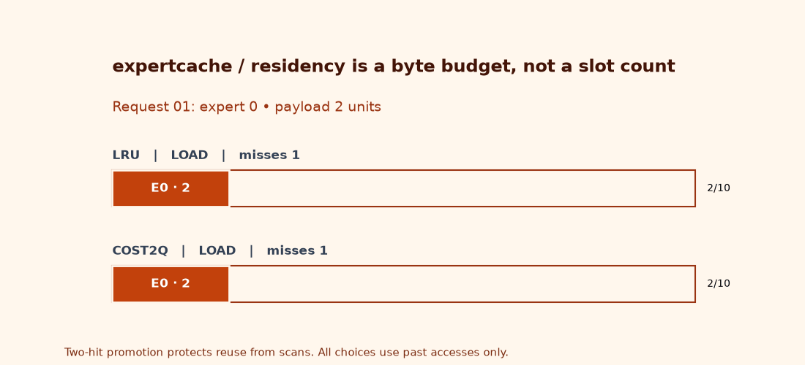
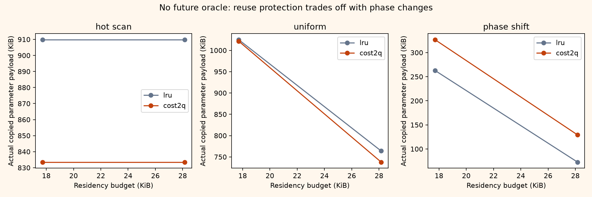

# expertcache

> **The useful cache question is not “how many experts fit?”**
> It is “which bytes should survive the next request?”

An online, trace-driven MoE residency planner paired with **actual tiny PyTorch expert execution**. Experts have different parameter sizes; routes acquire a byte-budgeted lease before loading or computing. Compare LRU with an aged, cost-density, two-hit policy. Replay the same routes against a fully resident bank and demand exact output parity.



An interactive version of the mechanism plate lives at [`assets/mechanism.html`](assets/mechanism.html).

*The animation is generated by the same `Residency.lease` implementation, not hand-scripted policy decisions. Widths represent illustrative payload units; the benchmark uses actual parameter bytes.*

## Two engineering deltas

### 1. Byte capacity plus reuse-aware eviction

A slot-count cache silently treats a 16-wide expert like a 48-wide expert. Here each expert costs its exact FP32 parameter payload. A miss may evict multiple unpinned experts. `cost2q` separates single-use probationary entries from recently reused entries, then ranks retention value per byte. It is an intentionally small **2Q-inspired heuristic**, not the canonical full 2Q algorithm: there is no ghost queue and no clairvoyant next-use table.

### 2. Transactional route leases plus a real execution boundary

Top-k routing needs the **whole current route** protected, not one expert loaded and immediately evicted while its neighbor arrives. Admission first checks the union of current pins and the deduplicated route. A request that cannot fit fails before mutation. Nested leases use reference-counted pins; body exceptions release them. Loading makes independent parameter copies, evicts actual cached modules before copying new ones, and executes the weighted expert outputs against an all-resident oracle.

A successful lease releases pins on exit but keeps warm residency. It does **not** roll back cache warming after execution failure. These are synchronous admission/pinning transactions, not durable storage transactions or asynchronous CUDA lifetime tracking.

## Actual results: sometimes protect reuse, sometimes move on

[Full machine-readable receipt](receipts/receipt.json) · [replay benchmark](benchmarks/run.py)

**ARM Neoverse-N1, 4 exposed cores, aarch64 Linux; Python 3.11.15; PyTorch 2.14.0+cpu; one Torch thread.** Four measured cold-cache replays after one warm-up. Each replay contains 176 top-2 routes / 352 expert uses. Bank: 14 two-layer GELU experts, width 16, hidden widths 16–48; variable FP32 payloads. No model downloads or learned routing quality claims.

| Trace | Budget bytes | LRU misses → cost2q | LRU copied bytes → cost2q | LRU CPU ms → cost2q |
|---|---:|---:|---:|---:|
| Hot pair + scans | 18,144 | 226 → 194 | 931,600 → 853,520 | 126.439 → 113.182 |
| Hot pair + scans | 28,832 | 226 → 194 | 931,600 → 853,520 | 124.491 → 115.010 |
| Uniform | 18,144 | 260 → 254 | 1,049,408 → 1,045,856 | 140.034 → 138.610 |
| Uniform | 28,832 | 187 → 174 | 782,320 → 755,616 | 115.669 → 111.876 |
| Phase shift | 18,144 | 62 → 78 | 269,024 → 334,464 | 69.022 → 76.075 |
| Phase shift | 28,832 | 18 → 31 | 74,544 → 132,400 | 52.847 → 59.327 |

**The counterexample matters.** At 18,144 bytes, cost2q removes 32 scan-trace misses and 78,080 copied bytes. But its reuse protection retains old-phase experts too long: 16 extra misses and 65,440 extra bytes on phase shifts. It is not a universally superior policy. Uniform gains at the smaller budget are tiny and not grounds for a throughput claim.

Every output in all 12 arms equals the all-resident reference **bit-for-bit**. Fully resident execution takes approximately **36.5–38.4 ms per trace**, markedly less than either offload-emulated arm. No claim is made that caching improves over enough memory to hold every expert. The receipt also reports a separate, clearly **modeled** serial-link transfer estimate (12 GB/s + 5 μs/miss, labeled `measured: false`); it stays well under 1.4 ms per replay and is never added to the measured CPU timings.



### What “measured” means here

- `bytes_loaded`: the sum of actual module parameter payloads deep-copied on misses. The engine separately counts copied bytes and the benchmark asserts equality with planner accounting. This is **not process RSS**, allocator traffic or PCIe traffic.
- CPU time includes policy lookup, eviction bookkeeping, Python `deepcopy`, and real expert forward passes. It excludes reference/parity assertions, plotting, and bank construction. Raw repetitions and resident baselines are retained.
- The backing bank remains in CPU RAM, and the cache holds independent CPU copies. Only **cached parameter payload** is capacity constrained; backing weights, activations, Python metadata and framework overhead are outside that budget. This emulates residency semantics, not a CPU-memory saving deployment.
- These fixed-seed synthetic traces are experiments, not production router traces. Policy decisions see the current route and past accesses only; the benchmark alone holds the full trace for replay.

## Policy specification

For width `d` and hidden width `h`, each FP32 two-linear-layer expert occupies:

```text
bytes(e) = 4 × (d·h + h + h·d + d)
resident_bytes = Σ bytes(e) ≤ capacity
pinned ⊆ resident
```

LRU evicts the least recent eligible expert. `cost2q` evicts the minimum lexicographic rank:

```text
age = current_expert_access_clock - last_access + 1
protected = (resident_hits ≥ 2) and (age ≤ 32)
value_density = min(resident_hits, 8) × (4096 + bytes) / (bytes × age)
rank = (protected, value_density, last_access)
```

`4096` is a **chosen setup-equivalent byte penalty**, not fitted or measured transport cost. Counts reset on eviction; promotion is resident-only, and aging gives old hot entries a way out. Two-hit separation resists scans; dividing by size accounts for variable payload; decay responds imperfectly to phases. There are no fitted predictions or next-use distances. Victim selection is an `O(number of resident experts)` scan per eviction—appropriate for this inspectable tiny product, not a million-entry cache.

The benchmark additionally reports a clearly **modeled** serial transfer estimate:

```text
T_link = copied_bytes / (12 × 10⁹ bytes/s) + misses × 5 μs
```

Neither the 12 GB/s bandwidth nor 5 μs setup has been measured on this host. This toy model omits overlap, contention, pageable versus pinned memory, queueing and batching. It is not used as a GPU speedup result. It is also separate from the policy's 4 KiB heuristic.

## Use the execution engine

```python
import torch
from expertcache.execute import Engine, make_bank, sizes_of

bank = make_bank([16, 24, 32, 48], width=16, seed=19)
sizes = sizes_of(bank)
engine = Engine(bank, capacity=sum(sorted(sizes.values())[-2:]), policy='cost2q')
x = torch.ones(1, 16)
y = engine.forward(x, route=[0, 3], weights=[0.4, 0.6])
print(y.shape, engine.cache.misses, engine.cache.bytes_loaded)
```

`lease([expert_ids])` deduplicates IDs for memory and pins, while execution preserves repeated route entries and their weights. Unknown experts, invalid sizes/budget, invalid policies, malformed weights and over-budget pin unions are rejected. Weights must be finite, nonnegative and sum to one. This CPU engine expects shape-compatible tensors and an immutable backing bank.

**Failure and concurrency boundary:** reference-counted nested leases are tested in the planner. `Engine.forward` is synchronous and single-owner; it is not a reentrant asynchronous runtime. A failed module copy drops phantom residency rather than recording a future hit; counters represent the attempted replay and should not be interpreted as successful DMA under allocation failure. Runtime shape errors release route pins and leave successfully loaded modules warm. Thread safety, request cancellation, background prefetch and actual CPU↔GPU copies are not implemented.

## Run the complete experiment

```bash
python3.11 -m venv .venv
. .venv/bin/activate
python -m pip install 'torch==2.8.0' --index-url https://download.pytorch.org/whl/cpu
python -m pip install -e '.[dev]'
OMP_NUM_THREADS=1 pytest -q
ruff check . && ruff format --check .
mypy expertcache
python benchmarks/run.py       # writes traffic PNG + receipt; ends PARITY_OK
python demos/make_visual.py    # real-policy animation, 10 frames + PNG still
python demos/demo.py           # same receipt entry point
python -m build --no-isolation
```

Local gates: **13 tests passed**, lint/format clean, typed package clean. Tests cover exact expert outputs, independent storage copies, actual/planned byte accounting, variable-size randomized replay (400 requests per policy), scan resistance, cost density, aging, unknown IDs, malformed configuration, atomic admission failure, nested pins, duplicate route IDs, exceptions and post-exception execution. `.github/workflows/verify.yml` repeats the CPU gates on Torch 2.8; it has been supplied but not claimed as remotely run.

## Reading map

| File | Owns |
|---|---|
| `expertcache/core.py` | byte budget, victim choice, pin references, admission invariants |
| `expertcache/execute.py` | real backing bank, copies, payload accounting, weighted expert execution |
| `benchmarks/run.py` | equal-budget comparisons, trace generation, CPU timing and separate link model |
| `demos/make_visual.py` | animation from live planner transitions |
| `receipts/receipt.json` | seeds, exact traces, sizes, raw timings, all 12 outcomes |

A useful next step is replaying captured production routes, then using CUDA events and pinned CPU buffers to measure real transfer/computation overlap. That requires hardware not available here; the current project does not manufacture those numbers.

## Papers, not copied implementations

Fast Inference of Mixture-of-Experts Language Models with Offloading studies constrained-memory MoE inference and parameter offloading; it motivates the residency problem, not this project's benchmark numbers.[1] Switch Transformers describes sparse expert activation and routing; expertcache isolates the inference memory-management boundary rather than implementing its training scheme or model.[2]

## Sources

[1] https://arxiv.org/abs/2312.17238
[2] https://arxiv.org/abs/2101.03961
